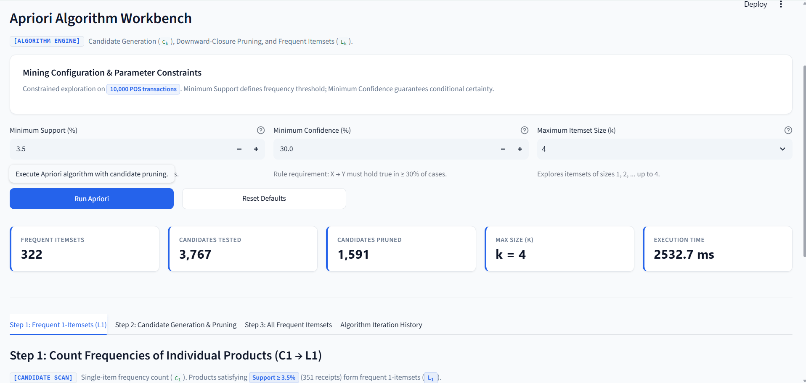
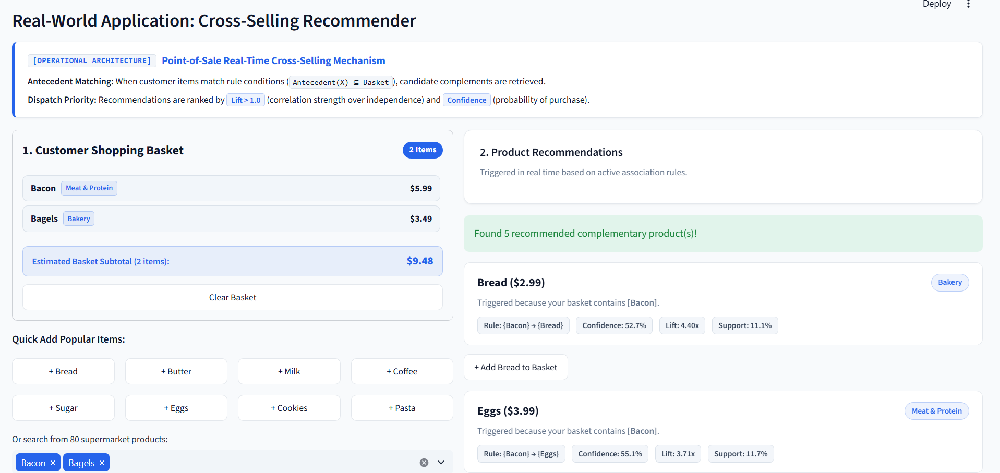

<div align="center">

# SmartCart: Association Rule Mining & Apriori Algorithm
### Interactive Market Basket Analysis Workbench

<p align="center">
  
  
  
  
  
  
  
</p>

<div style="background: linear-gradient(135deg, #eff6ff 0%, #dbeafe 100%); border: 1px solid #bfdbfe; border-radius: 12px; padding: 16px 24px; margin: 18px auto; max-width: 880px; text-align: left; color: #1e3a8a; box-shadow: 0 4px 14px -2px rgba(37, 99, 235, 0.1);">
  <b>Academic Curriculum Context:</b> This interactive laboratory application directly accompanies the lecture <b>Chapter 7: Association Rule Mining</b> and the foundational <b>Apriori Algorithm</b> in the <i>Intelligent System</i> course at <b>HCMUT</b>. It helps students understand how supermarket transactions are transformed into frequent itemsets and high-confidence actionable business rules via candidate generation (<i>C</i><sub><i>k</i></sub>), downward-closure pruning, and e-commerce cross-selling recommendations.
</div>

</div>

---

## Application Preview

<div align="center">

### 1. Apriori Algorithm Workbench
<p align="center" style="color: #64748b; font-size: 0.9rem; margin-top: -6px;">
  Interactive parameter constraints (Min Support, Min Confidence, Max <i>k</i>), candidate generation (<i>C</i><sub><i>k</i></sub>), downward-closure pruning, and frequent itemsets (<i>L</i><sub><i>k</i></sub>).
</p>


### 2. Real-World Cross-Selling Product Recommender
<p align="center" style="color: #64748b; font-size: 0.9rem; margin-top: -6px;">
  Live e-commerce checkout basket simulator generating instant cross-selling suggestions ranked by Lift (&gt; 1.0) and Confidence.
</p>


</div>

---

## Quick Start (Reproduce in 3 Steps)

### Prerequisites
- **Python 3.10+** (Python 3.11 or 3.12 recommended)
- `pip` package manager

---

### Step 1: Create and Activate Virtual Environment

<table>
<tr>
<th width="50%">Windows (PowerShell / Command Prompt)</th>
<th width="50%">macOS / Linux (Bash / Zsh)</th>
</tr>
<tr>
<td>

```powershell
# In project folder
python -m venv .env
.\.env\Scripts\Activate.ps1
```
*(If PowerShell restricts scripts, run: `Set-ExecutionPolicy -Scope Process -ExecutionPolicy Bypass`)*

</td>
<td>

```bash
# In project folder
python3 -m venv .env
source .env/bin/activate
```

</td>
</tr>
</table>

---

### Step 2: Install Required Libraries

```bash
pip install -r requirements.txt
```

<div style="background: #f8fafc; border-left: 4px solid #2563eb; border-radius: 4px; padding: 10px 14px; margin: 10px 0; color: #334155; font-size: 0.9rem;">
  <b>Zero External Download:</b> All transactional data is synthetically and deterministically generated in-memory using <code>SEED = 42</code>. The project runs <b>100% offline</b> on any machine without needing manual data setup.
</div>

---

### Step 3: Run the Web Application

```bash
streamlit run app.py
```

*The application will automatically launch in your default web browser (or navigate to the Local URL displayed in your terminal).*

---

## Application Modules & Learning Objectives

The application demonstrates the complete **Association Rule Mining & Apriori Algorithm** pipeline through **5 interactive tabs**:

<table>
  <thead>
    <tr style="background-color: #f1f5f9;">
      <th align="left" width="28%">Module Tab</th>
      <th align="left" width="40%">Description</th>
      <th align="left" width="32%">Key Pedagogical Focus</th>
    </tr>
  </thead>
  <tbody>
    <tr>
      <td><b>1. Transaction Overview</b></td>
      <td>Point-of-Sale (POS) supermarket receipts explorer (10,000 transactions, 80 products across 7 departments).</td>
      <td>Understand market basket structures, multi-item queries, and item frequency distributions.</td>
    </tr>
    <tr>
      <td><b>2. Apriori Workbench</b></td>
      <td>Interactive <b>Apriori Algorithm</b> engine with parameter controls (Minimum Support, Minimum Confidence, Maximum Itemset Size <i>k</i>).</td>
      <td>Visualize candidate generation (<i>C</i><sub><i>k</i></sub>), downward-closure subset pruning, and frequent itemsets (<i>L</i><sub><i>k</i></sub>) step-by-step.</td>
    </tr>
    <tr>
      <td><b>3. Association Rules</b></td>
      <td>Rule discovery engine extracting implication rules <i>X</i> &rarr; <i>Y</i> evaluated by Support, Confidence, and Lift.</td>
      <td>Scatter plot analysis, top rules ranking, and interactive rule dependency networks.</td>
    </tr>
    <tr>
      <td><b>4. Product Recommender</b></td>
      <td>Interactive e-commerce shopping cart simulator with real-time cross-selling suggestions.</td>
      <td>Bridge theoretical mining with commercial applications (Amazon / Walmart recommendation mechanism).</td>
    </tr>
    <tr>
      <td><b>5. Theory & Reference</b></td>
      <td>Formal mathematical formulations, proofs, Apriori property theorems, and workflow checklists.</td>
      <td>Lecture-aligned revision material for student assignments and exam preparation.</td>
    </tr>
  </tbody>
</table>

---

## Core Mathematical Formulations (Chapter 7)

- **Support ($s$):**
  $$\text{Support}(X) = \frac{\sigma(X)}{N} = \frac{|\{T \in \mathcal{D} \mid X \subseteq T\}|}{N}$$

- **Confidence ($c$):**
  $$\text{Confidence}(X \rightarrow Y) = \frac{\sigma(X \cup Y)}{\sigma(X)} = P(Y \mid X)$$

- **Lift ($L$):**
  $$\text{Lift}(X \rightarrow Y) = \frac{\text{Confidence}(X \rightarrow Y)}{\text{Support}(Y)} = \frac{P(X \cup Y)}{P(X) \cdot P(Y)}$$
  *(Lift $> 1.0$ indicates positive correlation; Lift $= 1.0$ indicates statistical independence)*

- **The Apriori Monotonicity Principle (Agrawal & Srikant, 1994):**
  $$\forall X \subseteq Y \implies \text{Support}(Y) \le \text{Support}(X)$$
  *(Any candidate itemset containing an infrequent subset is guaranteed infrequent and pruned immediately without scanning raw transaction storage)*

---

## Project Structure

```text
Demo/
├── .streamlit/
│   └── config.toml             # Theme settings (light palette, responsive layout)
├── assets/                     # Application UI demonstration previews
│   ├── apriori_workbench.png
│   └── product_recommender.png
├── data/
│   └── sample_transactions.csv # Example transactions for testing
├── src/                        # Algorithmic & educational engine
│   ├── __init__.py             # Package initialization (v1.0.0)
│   ├── apriori_engine.py       # Step-by-step Apriori engine, pruning, rule derivation
│   ├── datasets.py             # Reproducible synthetic dataset generator (SEED=42)
│   └── visualizations.py       # Plotly chart components (transparent, responsive)
├── tests/                      # Unit test suite
│   ├── __init__.py
│   └── test_apriori.py         # Algorithm test cases and verification
├── app.py                      # Streamlit application entry point
├── requirements.txt            # Minimal pip dependencies
└── README.md                   # Project documentation
```

---

<div align="center">
  <p style="color: #64748b; font-size: 0.85rem; margin-top: 24px;">
    <b>Faculty of Computer Science & Engineering — Ho Chi Minh City University of Technology (HCMUT)</b><br>
    Course: Intelligent System · Chapter 7: Association Rule Mining · Apriori Algorithm
  </p>
</div>
